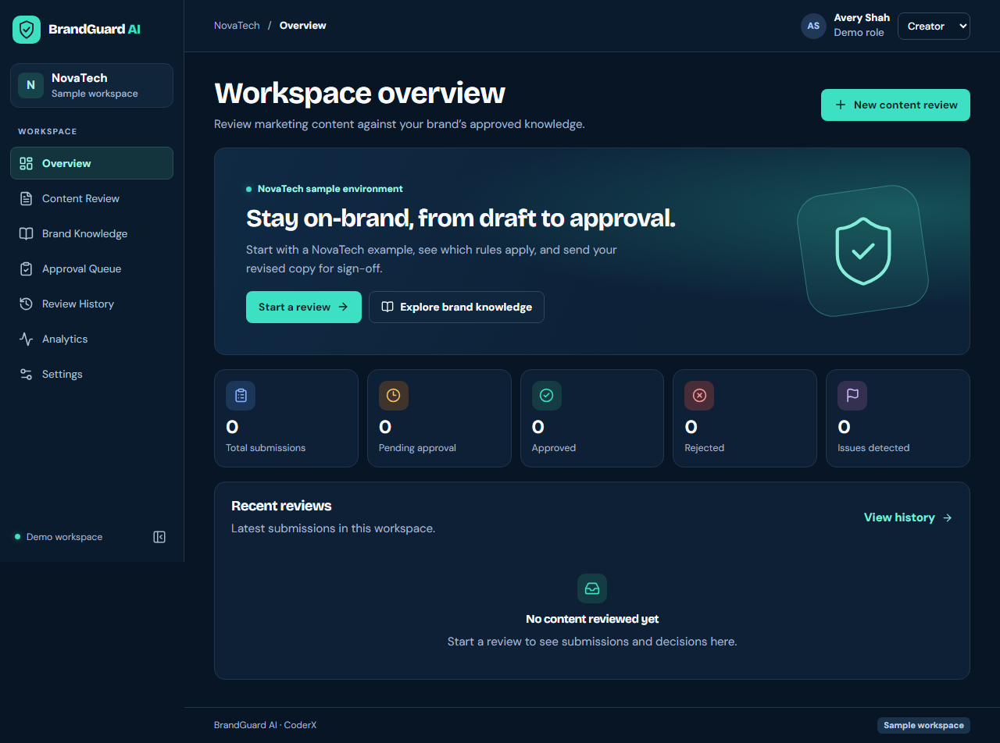
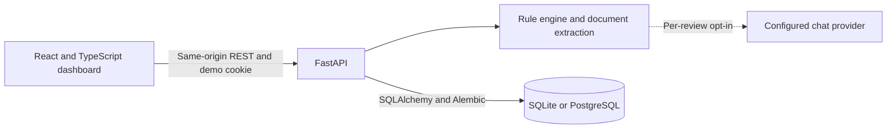

# BrandGuard AI

**CoderX · CodeNova India 2026 · Round 2 — The Build**
**Problem statement** Intelligent Brand Governance

Marketing teams need to catch inconsistent language and unsupported claims before publication. BrandGuard AI checks drafts against approved policy and product facts, shows the evidence for each finding, and records the human decision on a specific version.



## Run locally

Use Python 3.12 and Node.js 24 or newer. From the repository root on Windows PowerShell:

```powershell
py -3.12 -m venv .venv
.\.venv\Scripts\python -m pip install -r requirements-dev.txt -c requirements.lock
npm ci
npm run build
.\.venv\Scripts\python -m alembic upgrade head
.\.venv\Scripts\python -m uvicorn backend.main:app --host 127.0.0.1 --port 8000
```

On Linux or macOS, create the environment with `python3.12 -m venv .venv` and replace `.\.venv\Scripts\python` with `.venv/bin/python`. Open [the local app](http://127.0.0.1:8000), [interactive OpenAPI docs](http://127.0.0.1:8000/docs), or [the health endpoint](http://127.0.0.1:8000/health). For frontend development, run `npm run dev` in a second terminal and use the Vite URL. Vite forwards `/api` and `/health` to port 8000.

### Judge walkthrough

1. Open **Try Live Demo**. Each browser session gets its own NovaTech sample workspace and starts as Creator.
2. Open **Brand Knowledge** to view the messaging guidelines, product fact sheet, and enabled rules.
3. Choose **Content Review** and click **Analyze Content** on the prefilled sample. The review detects restricted terminology, two claims needing substantiation, and a subscription price contradiction.
4. Apply a suggestion or edit the copy. For a clean revision, try “Explore our AI-powered solution. NovaTech subscription plans start at ₹499 per month.”
5. Click **Re-run analysis**, then **Submit for approval**.
6. Select **Reviewer** from the demo role menu. Open **Approval Queue**, select the submission, enter a rationale, and record a decision.
7. Open **Review History** and select the submission. Reload the page to confirm the decision, then select Version 1 to inspect the original findings.

The demo entry point provisions its brand, rules, and sources transactionally on demand. A fresh private window starts a separate demo. For an API seed smoke test, run `python -m backend.seed` with the server running. The CLI seed creates a separate workspace.

## Features and architecture

- **Brand Knowledge** supports versioned rules, policy sources, activation and validity dates, and an editable brand profile. Admins can add sources manually or extract TXT, PDF, and DOCX text.
- **Content Review** supports pasted text, document imports, saved drafts, and source-grounded analysis. Findings record evidence status, severity, policy and source IDs, versions, and proposed edits where available.
- **Approvals** bind each decision to a revision and persist the actor, rationale, and timestamp. A new revision supersedes the previous approval state. The server enforces demo roles and workspace scope.
- **Analytics** reads real submission statuses, review dates, categories, severities, and frequently flagged rules from the database. Fresh workspaces start with zero submissions.



Vite builds static UI assets. FastAPI serves the frontend and API together, so production does not require a cross-origin API configuration. The one-service architecture reduces the number of deployment accounts and avoids cross-site demo cookies. The relational schema keeps workspace profiles, policy sources, rules, submissions, versions, reviews, findings, and decisions separate.

| Variable | Default or purpose |
| --- | --- |
| `DATABASE_URL` | `sqlite:///./brandguard.sqlite` locally. Production uses the internal PostgreSQL URL. |
| `SECURE_COOKIES` | Set to `1` behind public HTTPS. |
| `PORT` | Docker runtime port, 8000 by default. |
| `LLM_CHAT_URL` | Optional HTTPS chat-completions endpoint, including its path. |
| `LLM_MODEL` | Optional provider model ID. |
| `LLM_API_KEY` | Optional server-side provider secret. |

Copy [.env.example](.env.example) to `.env` if you need overrides. To migrate another database, set `DATABASE_URL` before running `python -m alembic upgrade head`. Production starts by applying that migration. To generate a subsequent revision, use `python -m alembic revision --autogenerate -m "describe the schema change"` and review the generated script.

### Analysis and data handling

Rule-based mode runs without credentials or external AI requests. Checks cover literal phrases, scoped monthly INR price floors, exact approved facts, configured tone guidance, select absolute claims, and a readability heuristic. An unsupported claim needs evidence. A contradiction has an applicable source or policy that conflicts with the draft. Ambiguous price scopes are marked for human review.

Configuring all three LLM variables enables a per-review opt-in. The service sends the draft and up to eight retrieved rule/source excerpts to the configured provider. It validates structured output, rejects unknown rule IDs and invented quotes, and labels accepted model findings for human review. A provider error or malformed output leaves the deterministic review available. The automated suite uses a simulated provider failure. Live provider behavior depends on operator configuration.

The public demo uses random opaque cookies and a separate database workspace for each visitor. Role switching is intentionally available within each fictional workspace. Uploads are limited to 5 MB, PDFs to 50 pages, and extracted text to 20,000 characters. The app persists text and source records, with no need to store raw binaries. Use fictional content in the demo.

## Tests

```powershell
.\.venv\Scripts\python -m pytest -q
npm run build
npx playwright install chromium
npm test
```

Playwright starts FastAPI against a test SQLite database and exercises the built frontend. Set `BRANDGUARD_TEST_DATABASE_URL` to a dedicated disposable PostgreSQL database to run the same suite against PostgreSQL. Set `BRANDGUARD_TEST_URL` to test an already running deployment. Tests create sample workspaces and decisions. Set `BRANDGUARD_SCREENSHOTS=1` to refresh the screenshots in this repository.

## Publish the judge demo

The repository includes a multi-stage Dockerfile and a Render Blueprint. No public deployment has been verified.

1. Commit the project and push it to the team's Git repository. Add the repository link to the submission.
2. In Render, create a Blueprint, connect that repository, and choose the branch containing `render.yaml`. Review the service and PostgreSQL plan costs before applying the Blueprint.
3. Let the first deployment complete. Render injects the internal `DATABASE_URL`, and the container runs Alembic before starting the API.
4. Verify the generated HTTPS URL and its `/health` endpoint. Open the root URL in a private browser window and confirm **Try Live Demo** works without signing in.
5. Run `npm test` with `BRANDGUARD_TEST_URL` set to that HTTPS origin. Add the verified demo and repository URLs to the report before submitting.

For another container host, build `docker build -t brandguard-ai .` and run the image with `DATABASE_URL` pointing to persistent PostgreSQL and `SECURE_COOKIES=1` behind HTTPS. For a local container, mount a writable volume at `/data` to persist the default SQLite database. See the [Render Blueprint specification](https://render.com/docs/blueprint-spec).

## Limitations and next round

The MVP is a fictional workspace demo with sample identities. Organisation sign-in, private user provisioning, and retention controls need additional work. The reviewer decides whether a draft with unresolved findings is acceptable. Deterministic checks cover configured patterns and scoped facts. Image checks, OCR, semantic embeddings, and full accessibility verification are outside this build.

Round 3 proposals are multimodal brand verification, publishing and collaboration integrations, and advanced governance intelligence. See the [Round 2 report](docs/round-2-report.md) and [readiness checklist](CHECKLIST.md).
