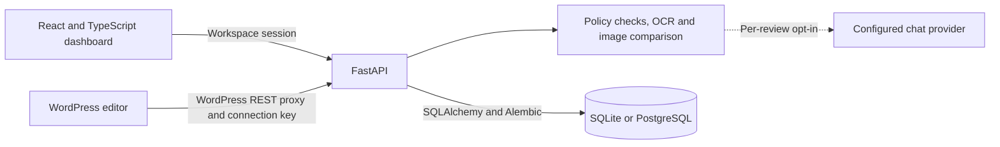

# BrandGuard AI

**CoderX · CodeNova India 2026**
**Problem statement** Intelligent Brand Governance

BrandGuard checks marketing copy and artwork against approved guidelines, brings human decisions into the WordPress block editor, and tracks recurring issues across campaign reviews.


## Run locally

Use Python 3.12 and Node.js 24 or newer. From the repository root on Windows PowerShell:

```powershell
py -3.12 -m venv .venv
.\.venv\Scripts\python -m pip install -r requirements-dev.txt -c requirements.lock
.\.venv\Scripts\python -m backend.ocr --install-english
npm ci
npm run build
.\.venv\Scripts\python -m alembic upgrade head
.\.venv\Scripts\python -m uvicorn backend.main:app --host 127.0.0.1 --port 8000
```

On Linux or macOS, create the environment with `python3.12 -m venv .venv` and replace `.\.venv\Scripts\python` with `.venv/bin/python`. Open [the local app](http://127.0.0.1:8000), [interactive OpenAPI docs](http://127.0.0.1:8000/docs), or [the health endpoint](http://127.0.0.1:8000/health). For frontend development, run `npm run dev` in a second terminal and use the Vite URL. Vite forwards `/api` and `/health` to port 8000.

### Judge walkthrough

1. Open **Try Live Demo**. Each browser session gets its own NovaTech sample workspace and starts as Creator.
2. Open **Brand Knowledge** to view the messaging guidelines, product fact sheet, and enabled rules.
3. Choose **Content Review** and click **Analyze Content** on the prefilled sample. The review detects restricted terminology, two claims needing substantiation, and a subscription price contradiction.
4. Apply a suggestion or edit the copy. For a clean revision, try “Explore our AI-powered solution. NovaTech subscription plans start at ₹499 per month.”
5. Click **Re-run analysis**, then **Submit for approval**.
6. Select **Reviewer** from the demo role menu. Open **Approval Queue**, select the submission, enter a rationale, and record a decision.
7. Open **Review History** and select the submission. Reload the page to confirm the decision, then select Version 1 to inspect the original findings.

The demo entry point provisions its brand, rules, and sources transactionally on demand. A fresh private window starts a separate demo. For an API seed smoke test, run `python -m backend.seed` with the server running. The CLI seed creates a separate workspace.

## Features and architecture

- **Brand Knowledge** supports versioned rules, policy sources, activation and validity dates, and an editable brand profile. Admins can add sources manually or extract TXT, PDF, and DOCX text.
- **Content Review** supports pasted text, document imports, saved drafts, and source-grounded analysis. Findings record evidence status, severity, policy and source IDs, versions, and proposed edits where available.
- **Approvals** bind each decision to a revision and persist the actor, rationale, and timestamp. Editing copy or replacing artwork creates a new revision. The server enforces workspace scope and fixed roles in team mode.
- **Analytics** reads real submission statuses, review dates, categories, severities, and frequently flagged rules from the database. Fresh workspaces start with zero submissions.



Vite builds static UI assets. FastAPI serves the frontend and API together, so production does not require a cross-origin API configuration. The one-service architecture reduces the number of deployment accounts and avoids cross-site demo cookies. The relational schema keeps workspace profiles, policy sources, rules, submissions, versions, reviews, findings, and decisions separate.

| Variable | Default or purpose |
| --- | --- |
| `DATABASE_URL` | `sqlite:///./brandguard.sqlite` locally. Production uses the internal PostgreSQL URL. |
| `SECURE_COOKIES` | Set to `1` behind public HTTPS. |
| `BRANDGUARD_MODE` | `team` for fixed-role access. The container and Render Blueprint use team mode. Running from source defaults to the isolated demo. |
| `TESSDATA_PREFIX` | Optional directory containing `eng.traineddata`. The container includes the English language pack. |
| `PORT` | Docker runtime port, 8000 by default. |
| `LLM_CHAT_URL` | Optional HTTPS chat-completions endpoint, including its path. |
| `LLM_MODEL` | Optional provider model ID. |
| `LLM_API_KEY` | Optional server-side provider secret. |

Copy [.env.example](.env.example) to `.env` if you need overrides. To migrate another database, set `DATABASE_URL` before running `python -m alembic upgrade head`. Production starts by applying that migration. To generate a subsequent revision, use `python -m alembic revision --autogenerate -m "describe the schema change"` and review the generated script.

### Analysis and data handling

Rule-based mode runs without credentials or external AI requests. Checks cover literal phrases, scoped monthly INR price floors, exact approved facts, configured tone guidance, select absolute claims, and a readability heuristic. An unsupported claim needs evidence. A contradiction has an applicable source or policy that conflicts with the draft. Ambiguous price scopes are marked for human review.

Configuring all three LLM variables enables a per-review opt-in. The service sends the draft and up to eight retrieved rule/source excerpts to the configured provider. It validates structured output, rejects unknown rule IDs and invented quotes, and labels accepted model findings for human review. A provider error or malformed output leaves the deterministic review available. The automated suite uses a simulated provider failure. Live provider behavior depends on operator configuration.

The demo uses random opaque cookies and a separate workspace for each visitor. Uploads are limited to 5 MB, PDFs to 50 pages, images to 12 megapixels, and extracted text to 20,000 characters. The database stores normalised images, OCR word coordinates, findings, and the approved visual references used in each review. Database backups therefore contain artwork and unpublished drafts.

### Review artwork

1. As an admin, set the approved primary and secondary colours in **Settings** and upload the brand's approved PNG or JPEG logo variants. Up to six variants can be active.
2. As a creator, open **Content Review**, select or enter a campaign, attach artwork and optionally add accompanying copy. **Analyze Content** checks both in one assessment.
3. Open **Highlighted region** to locate a finding. Expand **Text recognised in artwork** to read the OCR result and **Approved visual references used** to see the palette and logos at review time.

OCR runs locally in an isolated English Tesseract worker. Logo comparison searches at multiple sizes for upright marks and checks shape and colour. Large, saturated regions outside the approved palette are flagged for inspection. Photographs, stylised text, rotated marks and additional logos can require manual inspection. Low-confidence or missing matches go to the reviewer. An OCR service failure returns a retryable error.

### Connect the WordPress block editor

1. In BrandGuard **Settings**, an admin can download the plugin ZIP and create a connection key for one WordPress installation. Install and activate the ZIP using **Plugins → Add Plugin → Upload Plugin** in WordPress 6.6 or later.
2. Copy the two constants from Settings into the site's `wp-config.php`, above the line that loads WordPress. Keep the key server-side. Optionally set `BRANDGUARD_CAMPAIGN` to the campaign name for submissions from this site.
3. Open a post or page, expand **BrandGuard review** in the document settings, and select **Send draft for review**. A BrandGuard reviewer can now inspect the findings and exact draft in **Approval Queue**.
4. The panel checks the decision every 15 seconds while open. **Refresh decision** checks immediately. Edits invalidate the displayed approval immediately and the changed snapshot can be sent for review.

The SHA-256 fingerprint covers the title, serialised block content including markup, excerpt, slug, and featured-media ID. Theme output, changes to the file behind a media ID, and third-party custom fields are outside that snapshot. A retry of an identical snapshot reuses its review. Each changed snapshot has its own decision. The panel advises editors and preserves WordPress publishing permissions. Revoking the connection key stops access while retaining review history.

### Campaign governance

**Campaign governance** shows each evaluated rule version, affected revisions, coverage, rate, and change in percentage points from the previous evaluated version. Each revision counts once per rule version, including clean assessments. Multiple occurrences and repeated analysis of the same unchanged draft do not inflate the rate.

Use **Recurring violations** for rules contradicted on two or more revisions or **Recurring findings** to include issues needing substantiation and human review. **Repeated conflicts** identifies incompatible guidance on the same wording across two or more revisions, including required versus prohibited terms and different replacements. Creator disputes are shown separately. Expand a rule to open the exact underlying assessment. Existing submissions appear under **Unassigned** and can be moved using **Change campaign**. Historical reviews without an inventory of evaluated rules show unknown coverage.

## Tests

```powershell
.\.venv\Scripts\python -m pytest -q
npm run build
npx playwright install chromium
npm test
```

Playwright starts FastAPI against a test SQLite database and exercises the built frontend. Set `BRANDGUARD_TEST_DATABASE_URL` to a dedicated disposable PostgreSQL database to run the same suite against PostgreSQL. Set `BRANDGUARD_TEST_URL` to test an already running deployment. Tests create sample workspaces and decisions. Set `BRANDGUARD_SCREENSHOTS=1` to refresh the screenshots in this repository.

The optional WordPress browser test uses a disposable connected WordPress installation. Set `BRANDGUARD_TEST_URL`, `BRANDGUARD_TEST_WORDPRESS_URL`, `BRANDGUARD_TEST_REVIEWER_KEY`, `WP_TEST_USER`, and `WP_TEST_PASSWORD`, then run `npm test -- wordpress.spec.ts`. The test sends a real post to the queue, records approval, and edits its markup in the block editor. The API suite also accepts `BRANDGUARD_TEST_DATABASE_URL` and uses an isolated PostgreSQL schema per test.

## Production deployment

Build with `docker build -t brandguard-ai .`. Serve the container behind HTTPS with `DATABASE_URL` pointing to persistent PostgreSQL, `BRANDGUARD_MODE=team`, and `SECURE_COOKIES=1`. The container runs as an unprivileged user and applies Alembic migrations before serving the built frontend. Back up the database before upgrading. Use `/health` to check database connectivity. The Render Blueprint configures a paid 2 GB web instance and a private PostgreSQL database. Review the compute and storage charges before applying it. [Render Blueprint specification](https://render.com/docs/blueprint-spec)

Run the following commands in the deployed service shell against the same database. The first command prints a workspace ID. Substitute that ID when issuing each person's key.

```sh
python -m backend.team create-workspace "Marketing"
python -m backend.team issue-key WORKSPACE_ID admin "Brand manager"
python -m backend.team issue-key WORKSPACE_ID creator "Content creator"
python -m backend.team issue-key WORKSPACE_ID reviewer "Brand reviewer"
```

Deliver each private key to its owner and retain the printed member ID for revocation. The sign-in page exchanges the key for a 30-day HttpOnly session cookie. The database stores only credential hashes. `python -m backend.team revoke-key MEMBER_ID` revokes that key and its active sessions. A new team workspace starts with an empty policy library. Add approved sources before creating rules. The historical [Round 2 report](docs/round-2-report.md) describes the earlier demo release.
