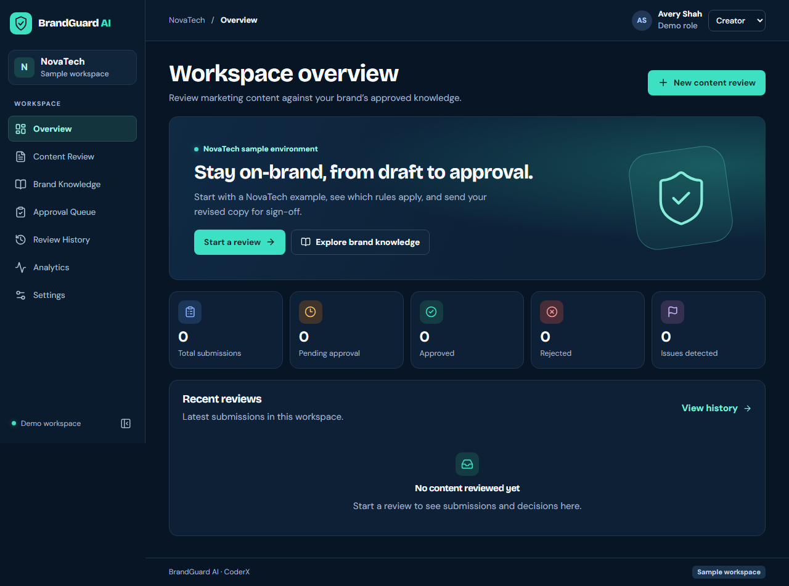
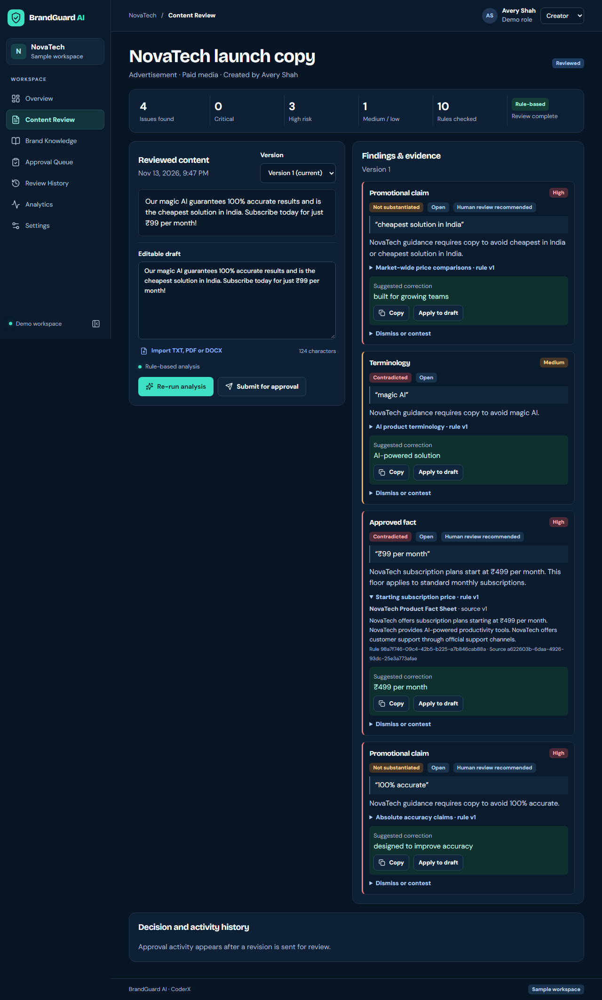
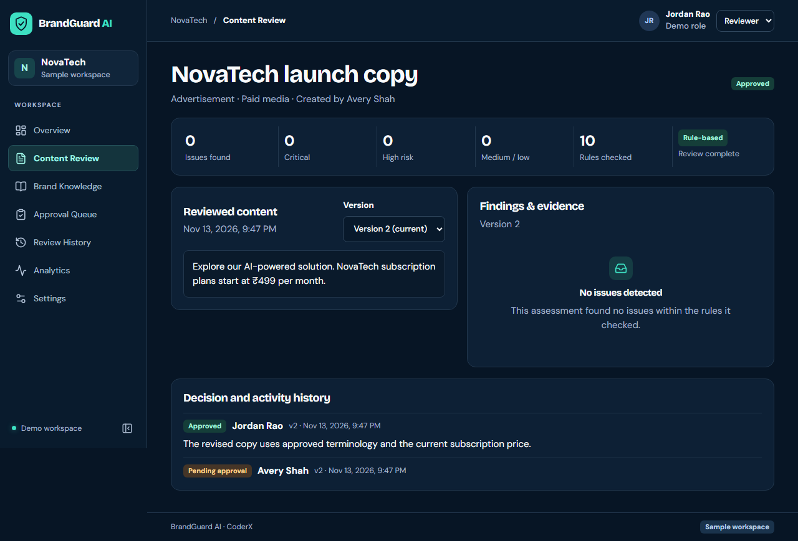

# BrandGuard AI

**CoderX · CodeNova India 2026 · Round 2 — The Build**
Organised by Inkloom AI · Intelligent Brand Governance

## Problem and users

Brand and marketing teams publish across channels and rely on employees, agencies, and AI tools for copy. Inconsistent terminology, unsupported promises, and stale facts can enter drafts when policy is checked manually. BrandGuard AI gives creators, brand admins, and reviewers a shared record from draft to decision.

## Implemented in Round 2

The workspace includes brand profiles, guideline and approved-fact sources, versioned rules, and text or document intake. The engine flags prohibited phrases, missing required terms, scoped pricing discrepancies, selected promotional claims, and readability concerns. Each grounded finding shows the rule and source version, plus a correction where appropriate. Creators can apply or copy corrections, record a contest or dismissal with a reason, and submit a reviewed revision. Reviewers can approve, reject, or request changes with a rationale. History preserves previous content and decisions, and analytics reads persisted activity.

## Product workflow

A judge opens the NovaTech demo and analyzes the sample. The rules identify “magic AI,” “100% accurate,” the cheapest-in-India claim, and ₹99 per month against an approved ₹499 monthly starting price. The judge edits the draft, re-runs analysis, and sends the revision to the approval queue. The sample reviewer records a decision, which the judge can reopen after refreshing the browser.

## Technical implementation and responsible AI

React and TypeScript deliver the dashboard. FastAPI serves the UI and REST API from one origin. SQLAlchemy stores workspace, policy, source, submission, version, review, finding, and approval records. Alembic manages migrations for SQLite and PostgreSQL. PyMuPDF and python-docx extract document text.

Deterministic checks run with no API key. The optional external model uses keyword-ranked policy context and requires explicit opt-in for each review. The service verifies cited rule IDs and quoted text, treats model observations as requiring human review, and falls back to deterministic results when the model response fails validation. The demo uses a random HTTP-only cookie, workspace-scoped queries, server-enforced demo roles, and bounded uploads.

## Changes from the plan and limitations

The brief’s Round 1 concept became a working, text-first governance workflow. The recommended Next.js and split hosting were simplified to a Vite frontend and one FastAPI service. Keyword retrieval and structured fact checks keep the demo independent of hosted inference or vector infrastructure. The current demo has sample identities and fictional data. Organisation authentication, OCR, image checks, embeddings, and broader factual validation are deferred. A live LLM provider and public deployment still require verification.

## Verification

The production frontend build and TypeScript check passed. Seven API tests covered seeded facts, dynamic policy, workspace isolation, approval permissions, revisions, upload extraction and validation, and malformed model output. Chromium exercised the complete judge journey and a mobile admin-rule scenario against SQLite and PostgreSQL. Screenshots came from the running app. Public HTTPS deployment and live-provider inference remain pending.

## Round 3 proposals

1. **Multimodal Brand Verification** — detect logos, compare layouts and colours with brand rules, and add visual accessibility checks.
2. **Publishing and Collaboration Integrations** — bring review to CMS publishing, design handoffs, and shared collaboration workflows.
3. **Advanced Governance Intelligence** — track policy changes, identify recurring rule conflicts, and compare compliance patterns across campaigns.

## Submission details

The Git repository and public demo URLs are pending publication. The CoderX team name is confirmed. Individual names and contribution credits should be supplied by the team before submission.
